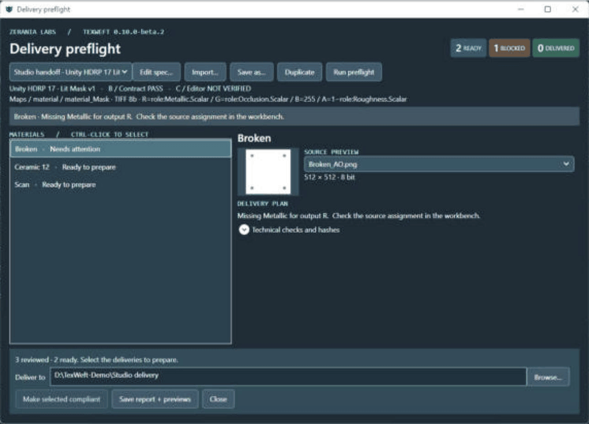
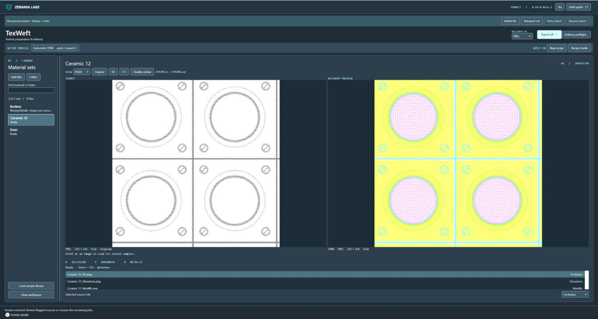
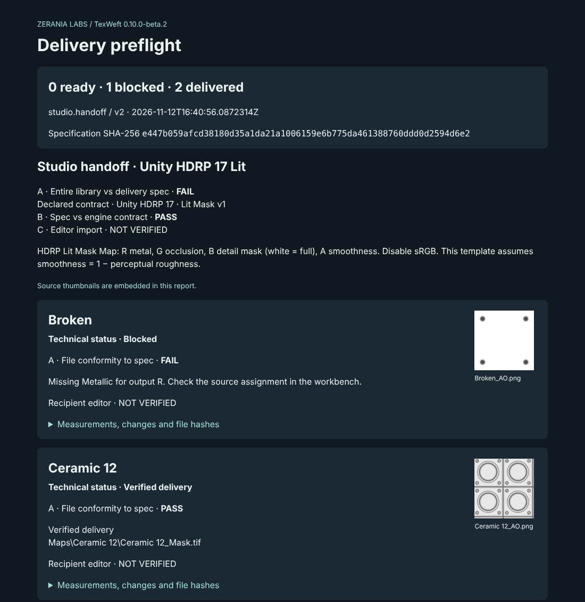
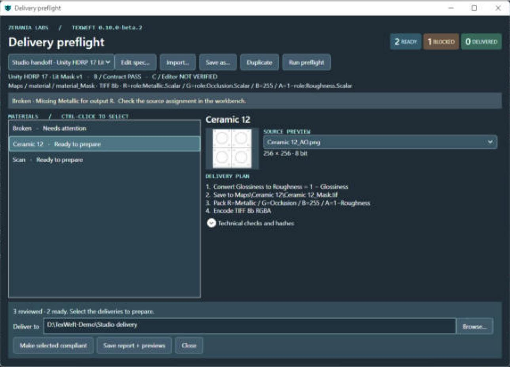
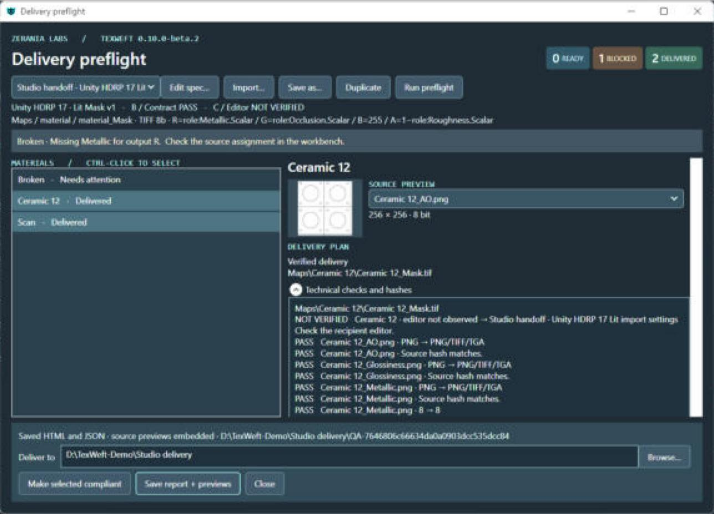
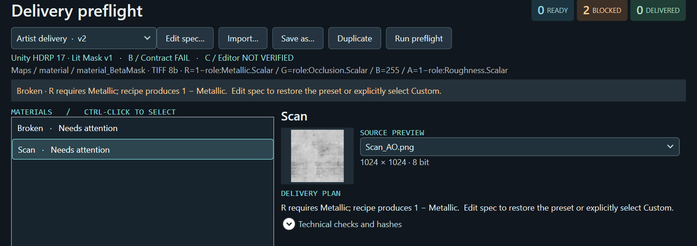

  

<h1 align="center">TexWeft</h1>

  <b>Texture preflight &amp; delivery for 3D artists.</b> 
  Pack your masks into the exact channel layout the client asked for, check them against their spec, 
  and hand over a QA report they can verify. Offline, on Windows.

  
  
  
  

  

---

## Which mask went into green?

You finish a prop. It looks right in your scene. Then the studio opens your delivery folder and asks:

- *Is this roughness or smoothness in the alpha?*
- *Why is the metallic channel inverted?*
- *Which version of the mask did you approve?*

Channel packing is invisible until it goes wrong, and it usually goes wrong **after** you've delivered.
TexWeft makes it visible **before** you deliver.

## What it does

| | |
|---|---|
| 🧩 **Packs channels for real engines** | Built-in contracts for **Unity HDRP 17** mask maps, **Unity URP 17** metallic, **Unreal Engine 5** ORM, **Godot 4** ORM and **glTF 2.0** metal-rough, or your own custom RGBA layout. |
| ✅ **Checks the delivery against the client's spec** | A small `.texweft-spec` file describes what the studio wants: names, folder, size, format, bit depth, channel meanings. TexWeft tells you what is ready, what it will fix and what is blocked, before writing a single file. |
| 🔁 **Glossiness or roughness, it doesn't matter** | Sources are recognised by name (`_AO`, `_Roughness`, `_Gloss`, `_Smoothness`, `_Metallic`…). Glossiness is complemented automatically and the report says so. |
| 🔍 **Inspects every plane** | Side-by-side source / delivery viewer, hidden RGB and alpha, per-pixel readout for 8 and 16 bit. |
| 🧾 **Hands over proof** | Each delivery gets a manifest with SHA-256 hashes of every source and output, plus an HTML + JSON QA report a recipient can open offline. |
| 🛟 **Never loses your batch** | Crash or close mid-batch: TexWeft reopens your library and resumes only the unfinished materials. Delivered files are re-read and verified. |
| 🔒 **Your assets stay on your machine** | No account, no cloud, no telemetry. Client textures are never uploaded anywhere. |

  

## How a delivery works

1. **Drop your texture folder** into TexWeft. Maps are grouped into materials by name.
2. **Import the client's spec** (or pick a built-in engine preset).
3. **Run preflight.** Every material is marked *Ready*, *Will fix* or *Blocked*, with the reason in plain words.
4. **Make selected compliant.** TexWeft writes the packed file, reads it back and checks it bit for bit.
5. **Save the report** and send it with the delivery.

  

Try it yourself: a real report, its JSON twin, a delivery manifest and the spec that produced them are in [`examples/`](examples).

  
  

When a spec contradicts its own engine (say, a mask map with metallic inverted), TexWeft stops and explains it instead of silently shipping a broken material:

  

## Formats and engines

| | |
|---|---|
| **Inputs** | PNG, TIFF, TGA · 8 and 16 bit · grayscale, RGB, RGBA |
| **Outputs** | PNG, TIFF, TGA · 8 and 16 bit · Gray / RGB / RGBA |
| **Resizing** | Keep size, area / bilinear, nearest |
| **Normal maps** | Explicit DirectX ↔ OpenGL (Y− / Y+) conversion |
| **System** | Windows 11 x64 (tested) · Windows 10 x64 expected · .NET Framework 4.8 (included in Windows) |

**How far each engine has been verified:**

| Target | File-level check | Imported in engine | Rendered comparison |
|---|:---:|:---:|:---:|
| Godot 4 · ORMMaterial3D | ✅ | ✅ | ✅ |
| glTF 2.0 · metal-rough | ✅ | ✅ | ✅ |
| Tangent normal Y conversion | ✅ | ✅ | ✅ |
| Unity HDRP 17 · Lit Mask | ✅ | in progress | in progress |
| Unity URP 17 · Lit Metallic | ✅ | in progress | in progress |
| Unreal Engine 5 · ORM | ✅ | in progress | in progress |

We only tick a box after it has actually been tested. Unity and Unreal import tests are part of the current beta.

## Free beta

TexWeft is in **public beta** (current build: `0.10.0-beta.2`).
We are looking for **20 artists** who deliver textures to studios, clients or asset stores.

**You get:** the full app for free during the beta, a direct line to the developer, and a **free licence of version 1.0** when you send your feedback.

**We ask:** try it on one real material set of yours and fill in a short feedback form.

👉 **[Apply for the free beta](https://github.com/JulietteMilo/TexWeft/issues/new?template=beta-tester.yml)** (takes 2 minutes, no email required)

## Planned pricing at launch

| | |
|---|---|
| **Founder price** | **€24.90** one-time, for the first 45 days after launch |
| **Regular price** | €29.90 one-time |
| **What's included** | One complete edition, every feature, commercial use of everything you deliver, all 1.x updates |
| **Store** | itch.io at launch (EU VAT handled by the store) |
| **What's not** | No subscription. No account. No feature tiers. |

⭐ **Star or watch this repository** to be notified on launch day.

## FAQ

**Does it replace Substance Painter or Designer?**
No. TexWeft starts where your authoring tool ends: it takes the maps you already have and prepares them for the person who will receive them. It works with exports from any tool.

**I already use ImageMagick or a script.**
If your naming and client specs never change, a script is fine. TexWeft is for when they do: a different spec per client, mixed PNG/TIFF/TGA sources, glossiness from one artist and roughness from another, and a recipient who wants proof.

**Is the HDRP/Unreal output guaranteed?**
The channel layout follows each engine's official documentation and is verified at file level. In-engine import tests for Unity and Unreal are running during the beta (see the table above). Godot and glTF are already verified in-engine.

**Where do my files go?**
Nowhere. Everything runs locally. TexWeft only reads your sources and writes to the folder you choose.

**Can I use the demo textures?**
Yes. The textures included in the demo are original Zerania Labs work and may be copied, modified and redistributed.

## Feedback and support

- 🐞 Found a problem? [Open a bug report](https://github.com/JulietteMilo/TexWeft/issues/new?template=bug-report.yml)
- 💡 Need a preset for another engine or game? [Request it](https://github.com/JulietteMilo/TexWeft/issues/new?template=feature-request.yml)
- 🌐 [zeranialabs.com](https://zeranialabs.com)

---

TexWeft is a product of Zerania Labs, an independent studio based in Italy. This repository is the public home of the product: documentation, examples, releases and the issue tracker. The application source code is not published. © 2026 Zerania Labs. All rights reserved. See <a href="LICENSE.md">LICENSE.md</a>.
